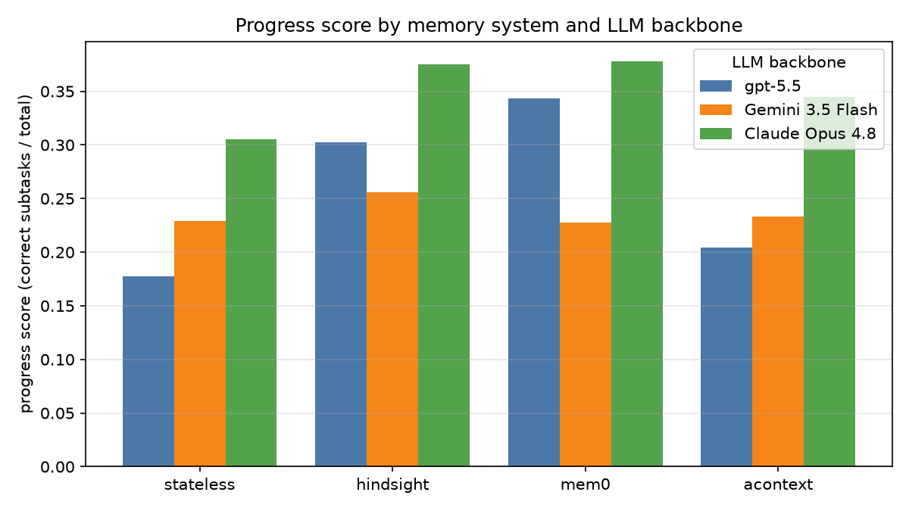
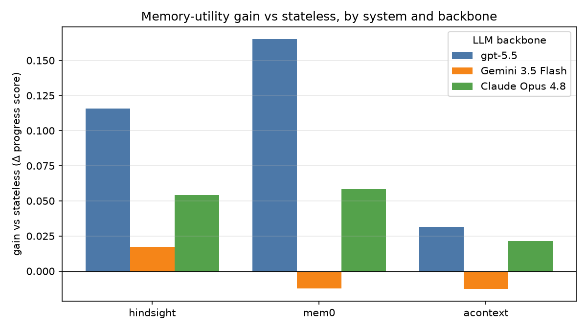
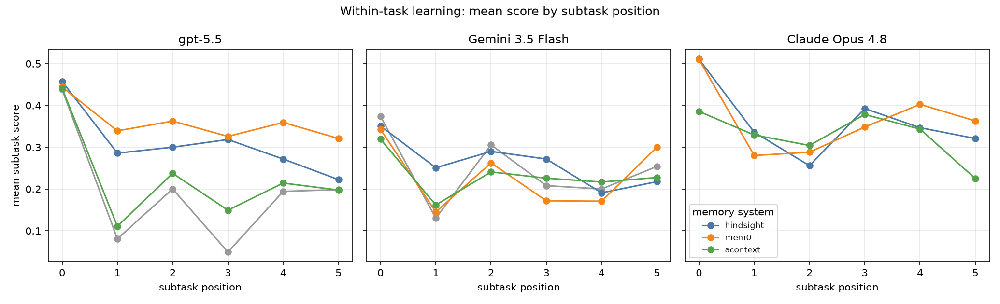

# Memory Matters — Benchmark Report

*Evaluating how memory mechanisms and LLM backbones affect agent learning behavior on iterative, interdependent tasks.*

This document summarises the study design, method, results, and limitations. Tables are copy-ready; figures are in [`docs/figures/`](figures/). All numbers come from `results/aggregated/` (produced by `make aggregate`) over the runs described below.

---

## 1. What we did (overview)

We integrated several existing **memory mechanisms** into a single agentic pipeline and compared them under **identical tasks**, across **three LLM backbones**. The goal is not a new memory mechanism, but a **controlled comparison** of existing ones — a factorial design over *memory system × LLM backbone × iteration depth*.

We ask four research questions:

- **RQ1** — How do different memory mechanisms affect agent performance and learning on iterative, interdependent tasks?
- **RQ2** — Do memory-augmented agents improve over the course of a task (within-task learning) versus a stateless agent?
- **RQ3** — How does the choice of LLM backbone affect memory-based learning?
- **RQ4** — How effectively do agents *retrieve* and *use* stored memory (relevance, correctness, usage)?

---

## 2. How we did it (method)

### 2.1 Benchmark and data
- **Benchmark:** MemoryArena. **Dataset:** HuggingFace `ZexueHe/memoryarena`, config **`bundled_shopping`**.
- **Task:** a multi-turn shopping task where each step (subtask) depends on remembering earlier decisions, budget, and constraints — so memory is directly relevant.
- **Sample:** **40 tasks** (random, seed 42) × **3 repeated runs** per task, ~6 subtasks/task. Repeated runs use isolated memory per seed (they measure variance/consistency, not cross-run learning); within-task learning is the subtask-position trend.

### 2.2 Memory systems (4 evaluated)
| System | Mechanism | Backend |
|---|---|---|
| **stateless** | no memory (control/baseline) | — |
| **hindsight** | reflection / experience memory | Vectorize Hindsight |
| **mem0** | vector memory store | Qdrant |
| **acontext** | skill-based memory | AContext (6-service stack) |

> **zep** (temporal knowledge graph) was **excluded** — see §5.

### 2.3 LLM backbones (3 compared)
| Backbone | Provider (via OpenRouter / direct) | Role |
|---|---|---|
| **gpt-5.5** | OpenAI direct | agent |
| **Gemini 3.5 Flash** (`google/gemini-3.5-flash`) | OpenRouter | agent |
| **Claude Opus 4.8** (`anthropic/claude-opus-4.8`) | OpenRouter (Anthropic-direct) | agent |
| gpt-4o-mini | shared | **LLM judge** + memory-system internal extraction |

The judge and each memory system's internal extraction model are held **constant** (gpt-4o-mini) across all conditions, so only the *agent backbone* changes — isolating the RQ3 effect.

### 2.4 Pipeline and scoring
Each `(task, memory system, backbone, seed)` runs the task's subtasks in order; the memory system accumulates memory across subtasks. Answers are graded by an **LLM judge** (deterministic token overlap cannot score MemoryArena's structured product-ID answers).

### 2.5 Metrics
- **progress_score** *(primary)* — fraction of a task's subtasks answered correctly, averaged.
- **memory_utility_gain_vs_stateless** *(primary)* — a system's score minus the matched stateless row (same task+seed+backbone). Positive = memory helped.
- **consistency** — 1 − contradictions against the task's fact ledger.
- **relevance / correctness / usage** — how relevant retrieved memory is, how factually correct it is, and how much the agent grounds its answer in it.
- **full-task success** — 1 only if *every* subtask is correct (all-or-nothing; near-zero on this hard task — see §5).
- **cost / latency** — USD per task (agent + judge) and wall-clock.

---

## 3. What we got (results)

### 3.1 Headline — per-backbone summary

Mean across the 4 memory systems (gain averaged over the 3 memory systems, excluding stateless):

| LLM backbone | Progress score | Mean gain vs stateless | Cost / task | Latency / task |
|---|---|---|---|---|
| **Claude Opus 4.8** | **0.351** | +0.045 | $0.078 | 33 s |
| **gpt-5.5** | 0.257 | **+0.104** | $0.238 | 106 s |
| **Gemini 3.5 Flash** | 0.236 | −0.003 | **$0.015** | **12 s** |

**Reading:** Opus 4.8 is the strongest agent overall; gpt-5.5 benefits *most* from memory (largest gain) but is the slowest and most expensive; Gemini 3.5 Flash is by far the cheapest/fastest but memory gives it essentially no lift.

### 3.2 Progress score by memory system × backbone

| memory system | gpt-5.5 | Gemini 3.5 Flash | Claude Opus 4.8 |
|---|---|---|---|
| stateless (baseline) | 0.178 | 0.229 | 0.306 |
| hindsight | 0.303 | 0.256 | 0.375 |
| mem0 | 0.343 | 0.228 | 0.378 |
| acontext | 0.204 | 0.233 | 0.344 |

### 3.3 Memory-utility gain vs stateless

| memory system | gpt-5.5 | Gemini 3.5 Flash | Claude Opus 4.8 |
|---|---|---|---|
| hindsight | **+0.116** | +0.017 | +0.054 |
| mem0 | **+0.165** | −0.012 | +0.058 |
| acontext | +0.032 | −0.013 | +0.021 |

**Reading:** memory helps most where the stateless baseline is weakest — gpt-5.5 starts low (0.178) and mem0/hindsight lift it substantially; Opus starts high (0.306) so has less headroom; Gemini Flash barely moves.

### 3.4 Within-task learning (RQ2)

Mean subtask score by position within a task, per backbone. This is the "improvement over time" signal — memory systems that carry useful context should hold up (or improve) on later, more memory-dependent subtasks relative to stateless.

### 3.5 Memory-use quality (RQ4)

Averaged across backbones (memory systems only):

| memory system | relevance | correctness | usage |
|---|---|---|---|
| mem0 | 0.111 | 0.998 | **0.842** |
| hindsight | 0.098 | 1.000 | 0.712 |
| acontext | 0.039 | 1.000 | **0.148** |

**Reading:** all systems store *correct* memories, but **retrieval relevance is low across the board**, and **acontext barely uses** what it retrieves (usage 0.15) — explaining its small gains. mem0/hindsight both retrieve *and* use memory, which tracks their stronger gains.

### 3.6 Cost & latency
Full per-cell cost/latency are in `benchmark_results.xlsx` (Per-model summary sheet). Headline: **Gemini 3.5 Flash is ~15× cheaper and ~9× faster than gpt-5.5**; Opus 4.8 sits in between on cost while leading on quality.

---

## 4. Key findings

1. **Memory helps — but unevenly.** mem0 and hindsight consistently improve over stateless; acontext is marginal. The benefit is largest for the weaker-baseline backbone (gpt-5.5) and negligible for Gemini 3.5 Flash.
2. **Backbone dominates absolute performance (RQ3).** Claude Opus 4.8 leads every system on progress score; the *relative* value of memory, however, is highest for gpt-5.5.
3. **Retrieval relevance, not storage, is the bottleneck (RQ4).** Stored memories are ~100% correct, but relevance is low and acontext's usage is near-zero — the skill abstraction is a poor fit for fact-recall shopping tasks.
4. **Cost–quality trade-off is stark.** Gemini 3.5 Flash gives ~67% of Opus's progress at ~1/5 the cost of Opus and ~1/15 the cost of gpt-5.5 — relevant if scaling the study.

---

## 5. Limitations, threats to validity, and failures (the honest part)

- **zep could not be evaluated (excluded).** The self-hosted Zep backend never started — legacy **Zep 0.27** requires config (`store.type`, pgvector) the compose didn't provide, and the adapter's `zep_python` **v2 client is API-incompatible** with a v1 server. Every zep run silently fell back to a local store (true for *all* backbones, including the original gpt-5.5 run). Those invalid runs are preserved in `results/EXCLUDED_zep_fallback/` and are **not** in any table here. Including Zep would require a modern Zep+Graphiti stack (or a correctly configured 0.27) — future work.
- **Full-task success is near-zero (~0.6%)** by design: it requires *every* one of ~6 subtasks correct. We therefore report **progress_score** (partial credit) and **gain** as primary metrics; treat "success" as a stretch indicator only.
- **Reliability (pass@3) is low** (0–0.05): the same task solved end-to-end on ≥1 of 3 runs is rare — MemoryArena bundled_shopping is genuinely hard.
- **Single domain, modest N.** 40 tasks, one domain (`bundled_shopping`), 3 seeds. Findings may not transfer to other MemoryArena domains.
- **Provider routing.** Claude was routed via **Anthropic-direct on OpenRouter** because Amazon Bedrock is disabled for this account (`ignore: ["Amazon Bedrock"]`); provider choice can affect latency/cost but not the model.
- **Engineering caveat.** The repo ran on a cloud-synced (OneDrive) filesystem, which intermittently locked result/log files; we added retry/backoff so this cannot corrupt results, but a small fraction of *diagnostic* raw-event lines were dropped (slightly sparse learning-curve sampling for some runs). Primary metrics are unaffected.
- **Memory internals held constant.** Each memory system's internal extraction and the judge use gpt-4o-mini across all conditions — intentional (isolates the agent backbone), but the absolute memory-quality numbers are tied to that choice.

---

## 6. Reproducibility

- **Config:** `configs/models.yaml` (slots: `openai_frontier` → gpt-5.5, `google_fast` → gemini-3.5-flash, `anthropic_opus` → claude-opus-4.8), `configs/benchmark.yaml` (profile `memoryarena_shopping`), `configs/openrouter.yaml` (Bedrock ignored).
- **Runs:** one RUN_ID per backbone — `benchmark_20260626T142817Z` (gpt-5.5), `benchmark_gemini35flash`, `benchmark_claudeopus48`. Each = stateless + hindsight + mem0 + acontext, 40 tasks × 3 seeds.
- **Aggregate + views:** `make aggregate` → `results/aggregated/` (`summary_by_memory_model.csv`, `subtask_trend.csv`, `paper_table.csv`, `leaderboard.csv`, `failure_categories.csv`).
- **Artifacts:** `benchmark_results.xlsx` (8-sheet workbook), `docs/figures/*.png` (this report's figures), dashboard at `make ui` → http://localhost:8501.
- **Regenerate figures:** `docker compose -p memory-agent-benchmark run --rm --no-deps -v "$(pwd):/app" --entrypoint sh stateless -c "pip -q install matplotlib && python /app/scripts/make_figures.py"`

---

*Data snapshot: 3 backbones × 4 memory systems × 40 tasks × 3 seeds = 1,440 task rows. Generated from `results/aggregated/`.*
